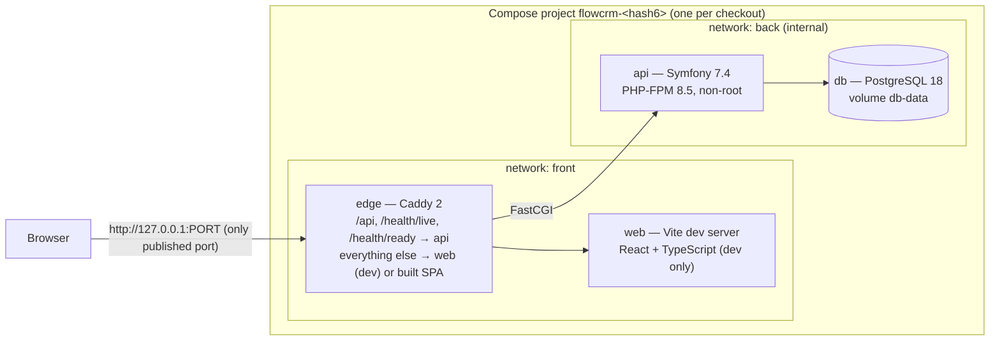

# FlowCRM

A customer relationship management platform for teams that need a clear view of their customers, sales opportunities, and day-to-day activities.

FlowCRM is designed around practical sales workflows, with a focus on data ownership, access control, automation, and maintainable application architecture.

## Project Status

**Foundation.** The development stack runs locally: a Symfony API under PHP-FPM, a React + TypeScript frontend with Vite, PostgreSQL, and Caddy as the single HTTP entry point. Users sign in with e-mail and password (server-side sessions), and each organization's data is visible only to its active members. There are no CRM features yet: after signing in you see your organization and its members. Users and organizations are created by the operator with console commands; there is no registration. Nothing is deployed.

## Planned Features

- Organization and user management
- Role-based access control
- Customer and contact management
- Sales pipelines and opportunity tracking
- Tasks, notes, and activity history
- Sales dashboards and reporting
- Notifications and background processing
- Data import and export
- Audit logs for important operations

## Technology Stack

| Layer | Technology |
| --- | --- |
| Backend | PHP 8.5, Symfony 7.4 LTS (modular monolith), PHP-FPM |
| Persistence | PostgreSQL 18, Doctrine ORM 3, Doctrine Migrations |
| Frontend | React 19, TypeScript 6.0, Vite 8 |
| HTTP edge | Caddy 2 |
| Infrastructure | Docker, Docker Compose v2, Make |
| CI/CD | GitHub Actions |
| Testing | PHPUnit, PHPStan, PHP-CS-Fixer, Vitest, Testing Library, Playwright, ESLint |

No cache server or message broker is part of the stack (ADR-007): sessions and the application cache use PostgreSQL, and rate limits and locks will too. If background processing becomes necessary, Symfony Messenger will start with its Doctrine transport.

## Architecture



- The browser talks to one origin, the Caddy edge; the API and the frontend are same-origin, so no CORS configuration exists.
- Only the edge publishes a port, on `127.0.0.1`. PostgreSQL, PHP-FPM and Vite are not reachable from the host.
- Backend modules follow the FCRM-003 module plan; the foundation contains only the small `Shared` module (health checks, the API status endpoint, problem details and request IDs). Module boundaries and layers are enforced with Deptrac ([backend modules](docs/architecture/backend-modules.md)).
- The core schema (users, organizations, memberships, pipeline, audit log) enforces its invariants in PostgreSQL, including composite tenant foreign keys and an append-only audit log ([data model](docs/architecture/data-model.md)).
- The API writes structured JSON logs to stderr; the edge, the API's log records and problem documents share one request ID per request ([observability](docs/architecture/observability.md)).
- Sessions and the application cache are stored in PostgreSQL (Symfony `PdoSessionHandler` and `DoctrineDbalAdapter`); sessions are lazy, so stateless routes set no cookie ([sessions and cache](docs/architecture/sessions-and-cache.md)).
- Authentication uses Symfony Security with these sessions: Argon2id passwords, a new session ID at login, an 8-hour absolute and 30-minute idle lifetime, Origin checks and a session-bound CSRF token for unsafe requests, and layered login throttling. Access to an organization is decided on every request from the user's active membership in the database; a foreign organization looks exactly like an unknown one (404) ([authentication](docs/architecture/authentication.md), [ADR-019](docs/architecture/adr/ADR-019-authentication-and-tenant-authorization.md)). The API contract is [`backend/openapi.yaml`](backend/openapi.yaml).
- The API connects as the least-privileged role `flowcrm_app` (explicit table privileges from `backend/config/database/runtime-privileges.yaml`, no DDL, append-only audit log); migrations run as the schema owner `flowcrm_owner` in a one-off `migrate` job; the PostgreSQL superuser is used only inside the database container ([ADR-018 database roles](docs/architecture/adr/ADR-018-database-roles.md)).

Details: [development lifecycle contract](docs/architecture/development-lifecycle-contract.md), [ADR-017 health endpoint routing](docs/architecture/adr/ADR-017-health-endpoint-routing.md).

## Getting Started

### Prerequisites

- Docker Engine or Docker Desktop with Docker Compose v2
- GNU Make 3.81 or newer and bash 3.2 or newer (the macOS defaults work)

PHP, Composer, Node.js and PostgreSQL are **not** needed on the host; they run in containers. `make doctor` checks the prerequisites without changing anything.

### First start

```console
$ make up
devenv: generated the local secret .runtime/secrets/db_password
devenv: generated the local secret .runtime/secrets/app_secret
devenv: generated the local secret .runtime/secrets/db_owner_password
devenv: generated the local secret .runtime/secrets/db_app_password
devenv: building images (the first build can take several minutes)
FlowCRM: http://127.0.0.1:8080
```

`make up` builds the images, starts PostgreSQL and checks its roles, starts the API and the Vite dev server, applies pending database migrations as the schema owner, verifies the runtime privileges, then starts Caddy on the first free port of 8080–8099. It reports success only after Docker's actual port mapping and `GET /health/ready` through the edge have been verified. Open the printed URL in a browser.

The database passwords (superuser `db_password`, schema owner `db_owner_password`, runtime `db_app_password`) and the Symfony secret are generated per checkout in `.runtime/secrets/` (git-ignored); no credentials are stored in the repository. Each container receives only the secrets it needs; the API never receives the superuser or owner password.

### Signing in

There is no registration: create a user and an organization with the operator console (the password is read from standard input, never from an argument), then sign in at the printed URL:

```console
$ api=$(docker compose -p "$(sed -n 's/^COMPOSE_PROJECT_NAME=//p' .runtime/dev.env)" ps -q api)
$ docker exec -it "$api" php bin/console flowcrm:user:create --email=ada@example.test --display-name='Ada Example'
$ docker exec -it "$api" php bin/console flowcrm:organization:create --name='Example Ltd' --admin-email=ada@example.test
```

`flowcrm:membership:add`, `flowcrm:user:reset-password`, `flowcrm:user:disable` and `flowcrm:user:enable` manage memberships and accounts; every change is audited ([authentication](docs/architecture/authentication.md#operator-console)).

### Developer commands

| Command | Purpose |
| --- | --- |
| `make up` | Start or reconcile the stack and print the URL |
| `make down` | Stop and remove the containers; **the database volume is kept** |
| `make restart` | `down` + `up`, keeping the port |
| `make status` | Services, health and the port mapping |
| `make url` | Print the verified URL (fails when the stack is not ready) |
| `make ports` | Diagnose port use in the range |
| `make logs` | Logs (JSON for `api` and `edge`); `SERVICE=edge\|web\|api\|db`, `TAIL=200`, `FOLLOW=1` |
| `make doctor` | Check the prerequisites |
| `make db-upgrade-roles` | Convert a database volume created before the role separation (verified backup first, see below) |
| `make db-rotate-password ROLE=app\|owner` | Rotate the runtime or schema owner password (development only); run it again to finish an interrupted rotation |
| `make db-rotate-password-abort ROLE=app\|owner` | Undo an unfinished rotation: the database gets the current password back |
| `make test-devenv` | Port allocator unit and real-Docker tests (fixture stack) |
| `make test-app` | Backend, frontend and application-stack tests |

Port selection, configuration (`FLOWCRM_HTTP_PORT`, `FLOWCRM_PORT_RANGE`, …) and exit codes are described in [docs/dev-environment.md](docs/dev-environment.md).

### Endpoints

All requests go through the URL printed by `make up`:

| Path | Served by | Response |
| --- | --- | --- |
| `/` and client-side routes | Vite (dev) / built SPA | the React application |
| `GET /api/v1/system/status` | Symfony | `{"service":"flowcrm-api","apiVersion":"v1","databaseTime":"…Z"}`, read from PostgreSQL |
| `GET /api/v1/auth/session`, `POST /api/v1/auth/login`, `POST /api/v1/auth/logout` | Symfony | the session, login and logout ([authentication](docs/architecture/authentication.md#endpoints)) |
| `GET /api/v1/me`, `POST /api/v1/me/password` | Symfony | the logged-in user, own password change |
| `GET /api/v1/organizations/{id}`, `…/members`, `…/members/{membershipId}` | Symfony | an organization and its member directory, for its active members |
| other `/api/…` paths | Symfony | RFC 9457 `application/problem+json` errors |
| `GET /health/live` | Symfony | `200 {"status":"live"}` while PHP-FPM serves requests |
| `GET /health/ready` | Symfony | `200 {"status":"ready"}`, or `503 {"status":"not-ready"}` when PostgreSQL is unreachable, its credential cannot be read or a migration is pending |

### Development workflow

- **Frontend:** `frontend/src`, `frontend/public` and `frontend/index.html` are mounted into the Vite container; changes appear immediately through hot module replacement over the same Caddy origin.
- **Backend:** `backend/src`, `config`, `migrations` and `public` are mounted read-only into the API container; PHP changes apply on the next request, and `make up` neither rebuilds nor recreates anything for them.
- **Dependencies or Dockerfiles changed** (`composer.json`, `package.json`, `docker/`, `backend/.env`, `backend/bin`): run `make up` (or `make restart`); the images are rebuilt and `make up` reports which services it recreated.

### Database migrations

Migrations live in `backend/migrations` (Doctrine Migrations). Every `make up` applies pending migrations in a one-off `migrate` container that connects as the schema owner `flowcrm_owner` (`doctrine:migrations:migrate --all-or-nothing`), also for a migration added while the stack runs; the command is idempotent, and a failing migration stops `make up` with exit 2. `/health/ready` reports `not-ready` while a migration is pending. To run a console command as the runtime role or as the owner:

```console
$ docker compose -p "$(sed -n 's/^COMPOSE_PROJECT_NAME=//p' .runtime/dev.env)" exec api php bin/console doctrine:migrations:status
$ docker compose -p "$(sed -n 's/^COMPOSE_PROJECT_NAME=//p' .runtime/dev.env)" run --rm --no-deps migrate php bin/console doctrine:migrations:status
```

New tables are invisible to the API by default: the migration that creates an object must grant its runtime privileges explicitly, and `backend/config/database/runtime-privileges.yaml` must list it. `make up` runs `bin/console app:database:verify-privileges --runtime` after the migrations and stops with exit 6 on any difference; a stack that was already running is then no longer served (its edge is stopped, `make status` reports `blocked`) until a `make up` passes ([ADR-018](docs/architecture/adr/ADR-018-database-roles.md)).

### Upgrading a database created before the role separation

A volume initialised before the role separation has only the superuser and is refused by `make up` (exit 6, nothing is started or converted). Upgrade it once, explicitly:

```console
$ make db-upgrade-roles
```

It generates the two role secrets, stops the API, web and edge, dumps the database and verifies the dump by restoring it into a scratch database (row counts, migration history, triggers), keeps the dump in `.runtime/backups/`, then moves the schema to `flowcrm_owner` in one transaction, runs the migrations and verifies the privileges. Data are not changed; running it again is safe. Then run `make up`.

### Data persistence and reset

The database lives in the Compose volume `<project>_db-data`. `make down`, `make up` and `make restart` never remove it; startup never re-initialises an existing database. To start from an empty database, explicitly remove the volume while the stack is down:

```console
$ make down
$ docker volume rm "$(sed -n 's/^COMPOSE_PROJECT_NAME=//p' .runtime/dev.env)_db-data"
$ make up
```

Keep `.runtime/secrets/` (and `.runtime/backups/`) as long as the volume exists: the database was initialised with those passwords. If one is lost, `make up` refuses to start rather than generating a non-matching password.

## Tests

```console
$ make test-devenv    # port allocator: unit tests and real-Docker scenarios on the BusyBox fixture
$ make test-app       # all of the following
$ tests/app/backend.sh    # composer validate/audit, PHP-CS-Fixer, PHPStan, migrations, PHPUnit (real PostgreSQL and PHP-FPM), security negative controls, Deptrac
$ tests/app/frontend.sh   # npm audit, type check, ESLint, Vitest, production build
$ tests/app/stack.sh      # real stack via bin/devenv: routing, health, persistence, isolation, browser
$ tests/app/prodlike.sh   # production-like stack: built SPA, caching, CSP, browser
$ tests/app/scan.sh       # Trivy scan: runtime images must have no HIGH/CRITICAL findings
```

The application tests run in their own Compose projects (`<project>-test`, `<project>-prod`, or temporary checkout copies) and remove only what they created. The same scripts run in the `Dev environment` job of GitHub Actions.

## Troubleshooting

| Symptom | Action |
| --- | --- |
| `make up` fails with exit 2 while starting the internal services | `make logs SERVICE=api` (for example a failing migration) or `SERVICE=db` |
| `does not answer /health/ready with 200` | the API is up but not ready: check `make logs SERVICE=api` for the logged reason |
| A dependency or Dockerfile change has no effect | `make restart` rebuilds the images |
| `.runtime/secrets/db_password is missing, but the volume … was initialised with it` (exit 6) | restore `.runtime/secrets` from a backup, or reset the database (see above); `make up` never generates a password that would not match |
| `.runtime/secrets/db_owner_password is missing, but the volume … exists` or `… was created before role separation` (exit 6) | the volume predates the role separation: `make db-upgrade-roles`; for an already upgraded volume restore the file from a backup or run `make db-rotate-password ROLE=owner\|app` |
| `… is malformed (expected 48 lowercase hex characters)` (exit 6) | restore the file from a backup, or `make db-rotate-password ROLE=owner\|app` |
| `the api's database role or privileges do not match …; the stack is not served` (exit 6), `make status` shows `blocked:` | the violations are listed above the message: grant the privileges in a migration and list the object in `backend/config/database/runtime-privileges.yaml`; a failed login means a stale `db_app_password` (`make db-rotate-password ROLE=app`) |
| `the database roles of … are inconsistent` (exit 6) | see the recovery table of [ADR-018](docs/architecture/adr/ADR-018-database-roles.md#recovery) |
| a password rotation was interrupted or failed | `make db-rotate-password ROLE=…` again finishes it, `make db-rotate-password-abort ROLE=…` undoes it; if the file was already replaced, `make up` recreates the containers |
| `project … has containers of another stack` (exit 6) | `FLOWCRM_STACK=fixture` and the application share a checkout's project; stop the other one with the command shown |
| More symptoms | see [docs/dev-environment.md](docs/dev-environment.md#failure-scenarios) |

## Known limitations

- No CRM features yet. The organization roles are a provisional, read-only matrix; membership management and tenant changes through the API, self-service password reset (there is no e-mail delivery) and the per-user API rate limit follow later ([authentication](docs/architecture/authentication.md#known-limitations)).
- The production-like configuration is tested locally and in CI only; there is no deployment.
- The API image is rebuilt when PHP dependencies change; there is no hot reload of Composer packages.

## Development Roadmap

- [ ] Define domain boundaries and data model
- [x] Set up Symfony and React applications
- [x] Configure Docker, Makefile, and CI
- [ ] Implement authentication and authorization
- [ ] Build customer and contact management
- [ ] Implement sales pipelines
- [ ] Add activities and notifications
- [ ] Implement reporting and audit logs
- [ ] Complete testing and security review
- [ ] Prepare a public demo

## License

License to be determined.
